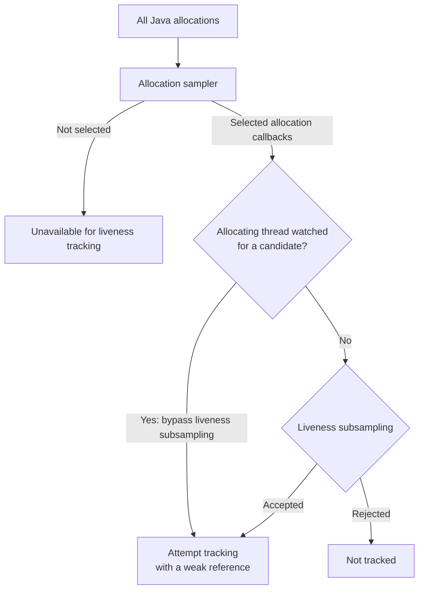

<!-- Copyright 2026, Datadog, Inc. -->

# Reference-chain collection summary

## Purpose

Reference-chain collection helps explain why a sampled object remains live. It records a
chain of referrer classes from a GC root to a sampled object. It does not replace a heap
dump or compute an exact retained set.

The feature is disabled by default. It requires an active allocation sampler and a leak
signal from generations tracking or chain-enabled liveheap tracking. Example options are
`generations=true,referencechains=true` or `memory=4m:l,referencechains=true`.

The bare `referencechains=true` option does not activate the allocation engine or supply
candidates. Without a signal source, the collector cannot start a search.

The [Reference Chain Collection wiki](https://datadoghq.atlassian.net/wiki/spaces/~5d4b47deba36300d23e5053d/pages/6973555518/Reference+Chain+Collection)
provides the end-to-end overview. This summary links to the detailed repository references.

## Data flow

1. `LivenessTracker` groups surviving tracked samples by class and distinct GC age.
2. It selects classes with sustained growth and qualifying allocating-thread evidence.
3. It assigns leak tags to tracked instances in those class/thread groups.
4. `ReferenceChainTracker` walks from roots toward those tagged instances.
5. The tracker preserves frontier tags, parent links, and pending queues between passes.
6. Candidate polling reconstructs chains and stores them in a resolved-chain cache.
7. The dump and stop paths write cached chains as `datadog.ReferenceChain` events.

In this document, *class* means the Java class. Source identifiers use the existing
`klass` spelling.

## Candidate selection

Each class-history value counts distinct GC ages among surviving tracked instances, not
raw live-instance counts. The table holds at most 256 classes, each with a 30-value ring.
The tracker requires at least 10 values before evaluating a class trend.

A linear regression must show fitted endpoint growth of at least the larger of 15% of
its fitted starting value and one distinct age. The rise need not be strictly monotonic.
Five consecutive qualifying folds are required, or three when heap-floor growth corroborates it.

At least one allocating thread must also qualify for the class. A thread qualifies through
its surviving-age trend or at least eight retained tracked instances. Its consecutive
qualification must meet the same hysteresis threshold. At most five classes are selected.

Cleanup folds a value for the latest processed GC epoch; intervening epochs can be
coalesced. Allocation-path overflow cleanup only reaps. Dump/stop cleanup and periodic
background cleanup perform the trend fold under the existing table lock.

Candidate selection uses sampled objects. Sampling, incomplete history, and the class/thread
gates can prevent a leak from producing a candidate.

## Resumable walk

`ReferenceChainTracker` owns a background thread and a persistent frontier. The frontier
contains positive JVMTI tags. A tag does not keep an object live; lookup can stop returning
an object after it is collected.

Each pass can perform these operations:

1. Enumerate roots and stack references on the first pass or when the retry interval permits.
2. Walk candidate thread objects when qualifying thread data is available.
3. Continue a pending static-field sweep in loaded-class chunks.
4. Expand batches of frontier entries through a shared object-array holder.
5. Revisit selected entries whose references can change after their first expansion.

Root-enumeration attempts wait at least two seconds after the previous attempt, with a
cost-based extension capped at 30 seconds. Truncated attempts use the same interval and
end that pass's traversal phases. Later passes can expand already-admitted roots.

The walk records parent tags, classes, depth, root kind, edge identity, and leak-tag
ownership. These records can combine observations from different passes. They do not
form a consistent heap snapshot.

## Candidate correlation

`tagLeakInstances()` uses a pool of 256 positive leak tags. It tags instances from qualifying
class/thread groups, or correlates their existing frontier entries without overwriting
frontier tags. The collector keeps up to eight discovered instances per watched class.

Representatives are weak references, not artificial traversal seeds. The collector must
discover a root-to-instance path before reconstructing that instance's chain.

Allocation sampling and liveness admission are separate stages:

The diagram shows normal admission. Near projected memory exhaustion, a separate global
boost can also bypass liveness subsampling. Neither boost bypasses the allocation sampler,
tracking-table limits, or lock-contention drops.

Tracking is not allocation-free: `track()` creates a weak global reference and can grow
the tracking table. The expensive class-history fold is kept off that callback path.

## Mutable-container coverage

A long-lived collection can receive references after its first expansion. Bounded rotation
revisits leak-accumulating parents, stale expanded entries, transient-root entries, and static
anchors. This adds opportunities to discover changed references, not complete mutation coverage.

## Cost controls

The controls have different scopes; they are not independent hard latency guarantees:

- Ordinary edge-admission gates count new objects, not all callbacks or elapsed time.
- Callback deadlines apply to selected traversal phases, not root enumeration.
- A PID controller adjusts edge budget and cadence from measured heap-walk-call time.
- Running-search spacing is normally at least `max(effective cadence, 100 ms)`.
- Safepoint-cost debt delays a later search; it does not cap the running search's total cost.
- CPU-cost debt gates running-search passes using a manual-walk wall-time proxy.
- Frontier and hop caps restrict metadata and admission depth; the hop cap only prunes branches.

Several traversal phases receive separate deadlines. JVM work and callback granularity can
cause overshoot. Neither the pause target nor the admission budget bounds a whole pass's
application pause time.

Root enumeration does not use the deadline, and its admission budget does not count every
examined root. For this release, a root-enumeration pause is acceptable if it is shorter
than three seconds. This is an acceptance threshold, not a hard real-time guarantee.

See [root discovery](architecture/LiveHeapReferenceChainsImplementation.md#root-discovery)
for the enumeration controls and limitations.

After a five-minute process-first-signal burn-in, usable heap/container projections can
increase work below a 30-minute exhaustion horizon. Below five minutes, an urgent latch
suppresses ordinary no-progress abandonment. Urgency never substitutes for a leak candidate.

`stopThread()` requests cooperative cancellation. Root and reference callbacks check the
request; shutdown still depends on callback progress.

## Completion and abandonment

Completion requires a completed root enumeration and either all current candidates found
or no pending work and no class under watch. Incomplete enumeration defers TTL and ordinary
no-progress abandonment; the configured TTL is not a hard search-lifetime bound.

The abandonment reasons are:

- `FRONTIER_CAP`: the frontier cannot admit another entry.
- `TTL`: lifetime expired or 30 prior passes made no frontier progress, subject to the deferrals.
- `ROOT_ENUM_ERROR`: three consecutive root-enumeration attempts returned JVMTI errors.
- `CANARY_STUCK`: both frontier and candidate progress met their stall limits. This can occur
  during urgency or when incomplete enumeration suppresses the earlier no-progress exit.

Abandonment events use a separate queue. The current writer maps `ROOT_ENUM_ERROR` to
`unknown`. Recording stop does not enqueue a `RECORDING_END` abandonment event.

A restart requires released search tags, cleared safepoint-cost debt, the root-enumeration
interval, and a current leak candidate. A running search does not restart itself.

## Output and limits

The resolved-chain cache holds at most 128 entries. Dump snapshots keep eligible entries
for later chunks; they do not guarantee a chain for every live sample in every chunk.
Leak-tag incarnation checks reject chains for former owners of reused tags.

Chains and edge labels use leaf-to-root order. Shallow stack-local/JNI-local chains are
suppressed. A separate serializer hop cap can truncate output; compare `totalHops` with
the emitted array length. Correlate leak-tagged targets using both tag and incarnation.

Callbacks queue bounded invalidations under a spin lock, not a lock-free protocol. Candidate
polling and dump snapshots drain them; a dump can drain during traversal. Cache pressure
and abandonment-queue overflow can also drop events.

The output is diagnostic history, not a complete object graph, an exact retained set,
or proof of the shortest or only retaining path.

See [LiveHeapReferenceChainsImplementation.md](architecture/LiveHeapReferenceChainsImplementation.md)
for traversal and output, and
[ReferenceChainsSignalsExplained.md](architecture/ReferenceChainsSignalsExplained.md) for scheduling.
