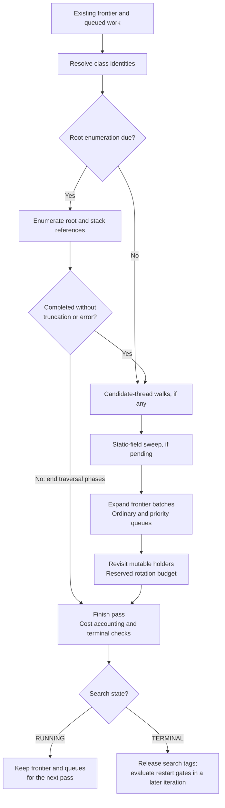

<!-- Copyright 2026, Datadog, Inc. -->

# Live-heap reference chains: implementation reference

**Status:** Implemented and disabled by default

## Scope

This document describes the current reference-chain implementation. It focuses on data flow, traversal, lifecycle, limits, and output.

Related documents:

- [Reference-chain design](../ReferenceChainsDesign.md) records the design decision and trade-offs.
- [Reference-chain collection summary](../ReferenceChainsCollectionSummary.md) gives a short overview.
- [Reference-chain scheduling and cost control](ReferenceChainsSignalsExplained.md) explains scheduling.

## Main components

`LivenessTracker` detects growth in the number of distinct GC ages among surviving tracked
samples of a class. Candidate selection also requires qualifying allocating-thread evidence.
It assigns leak tags to instances in those class/thread groups.

`ReferenceChainTracker` maintains a root-based frontier and searches for those instances. It runs on one agent-owned background thread. `_engine_lock` serializes engine state across lifecycle and test paths.

`FrontierTable` stores one record for each admitted object. Important fields include:

| Field | Purpose |
|---|---|
| `parent_tag` | Identifies the entry that admitted this object. Zero means that the entry is root-attached. |
| `referrer_klass` | Identifies the object's class in the profiler class dictionary. |
| `referrer_class_tag` | Class tag of the referrer when the referrer is a class object (a root-attached static-field admission, where there is no parent entry). Zero otherwise. |
| `referrer_field_index` | Field index of the admitting edge (-1 when the edge is not a field or static-field edge). Used to label each hop in the emitted chain. |
| `edge_kind` | JVMTI reference kind of the admitting edge for an interior hop (`parent_tag != 0`). |
| `depth` | Records the number of edges from the root. |
| `state` | Records `FRONTIER`, `EXPANDED`, or `ABANDONED` in the production walk. `EDGE` is used only by fixtures and `markEdge()`. |
| `root_kind` | Records the JVMTI root or edge kind for a root-attached entry. |
| `class_tag` | The entry's own object class tag. It provides class identity across class-dictionary regeneration. |
| `leak_tag` and incarnation | Correlate the entry with the current owner of a sampled leak tag. |

## Search lifecycle

A search starts only when the safepoint-cost gate and root-enumeration interval permit it,
and the enabled leak signal supplies a candidate. Urgency does not replace that candidate.

The first pass starts the search timestamp and enumerates roots. Later passes resume the same frontier. A running search does not restart itself.

A terminal search releases its search-owned tags. A later search must wait for release,
cleared safepoint-cost debt, the root-enumeration interval, and a current leak candidate.

`restartSearch()` resets the frontier state and the frontier-tag sequence. Stable class tags and valid resolved-chain entries have separate lifecycles.

## Pass structure

`runPass()` resolves loaded classes and calls `runPassManualWalk()`. The pass can contain these phases:

1. Root and stack-reference enumeration.
2. Candidate thread-object traversal.
3. Static-field scanning.
4. Ordinary frontier expansion.
5. Rotation and static-anchor traversal.

Candidate thread traversal, ordinary frontier expansion, and rotation each receive a fresh
callback deadline. Static-field scanning does not receive a fresh deadline. It shares the
candidate-thread deadline when that phase runs. Otherwise, it uses the deadline set before root
enumeration. Earlier work can therefore reduce or consume the time available for static-field
scanning.

The tracker times `runPassManualWalk()` and the heap-walk calls within it. Their elapsed-time
difference supplies the CPU-cost budget; it is not measured CPU consumption. Class resolution,
candidate polling, and search-tag release are outside that timed region.

For a running search, the phase order and root-enumeration early exit are:



Frontier-cap failures in earlier phases can also skip later work. Ordinary expansion
truncation does not by itself skip reserved rotation work. A finished pass need not mean
a completed search.

## Root discovery

### Root and stack references

`IterateOverReachableObjects()` calls `heapRootCallback()` and `stackRefCallback()`. These callbacks admit root-attached objects. They do not traverse all children of each root.

The first pass always enumerates roots. Later attempts wait after the previous attempt ends:
`max(2 s, min(last attempt duration in ms × 20 ms, 30 s))`. This interval applies to
truncated and errored attempts and also gates restarted searches.

A truncated or errored enumeration ends the traversal phases of that pass. Later passes
can expand already-admitted roots while waiting for the next enumeration attempt.

Root enumeration uses `firstpassbudget`, including attempts after the first pass.

This phase does not use the callback deadline or keep an enumeration cursor. Repeated
attempts can examine already-admitted roots without charging admission budget. Direct-root
leak-tag conversion also bypasses the ordinary admission-budget check; elapsed time is not bounded.

For this release, a root-enumeration pause is acceptable if it is shorter than three
seconds. This threshold is not the desired latency and is not a hard real-time
guarantee. [PROF-16284](https://datadoghq.atlassian.net/browse/PROF-16284)
tracks separate measurement and a progress-preserving mitigation.

### Static fields

Root callbacks do not provide the static-field edges needed by this implementation. `admitStaticFieldRoots()` therefore scans loaded classes with `FollowReferences()`.

The scan:

- Partitions each `GetLoadedClasses()` result so application classes come first.
- Processes at most 512 classes in one chunk.
- Saves a cursor and retries a truncated chunk.
- Admits static-field edges.
- Admits at most 32 other class edges per class.
- Starts a new completed sweep when the loaded-class count changes.

Before applying the cursor, the code sorts each application/bootstrap partition by stable
class tag. The cursor therefore does not depend on the API returning classes in the same order.

### Candidate thread objects

Candidate selection records qualifying native thread identifiers. The tracker maps them to Java `Thread` objects and walks a rotating set of at most four thread objects per pass.

The descend walk admits at most 16 hops below an anchor and still obeys the global hop cap. This path improves coverage for `ThreadLocal` retention. It does not assume that every candidate is thread-local.

## Frontier expansion

`expandFrontier()` takes a batch of pending frontier tags and calls `GetObjectsWithTags()`. Dead objects do not resolve and leave no object to expand.

The tracker places resolved objects in one JNI object array and calls `FollowReferences()`
with that array as its initial object. Callback filtering normally admits one hop from
selected boundary objects. Priority and ordinary queues alternate batches when both have work.

The adaptive resolution-batch target is between 8 and 512, using proportional feedback
from measured call time. Queue length and remaining budget can make an actual batch smaller.

If JNI setup fails or leaves an exception, the tracker marks the operation as truncated. It does not mark the affected entries as expanded. A later pass can retry them.

Ordinary admission gates count new objects, not every callback. Reference callbacks check
the deadline every 4,096 invocations, and expansion also checks its outer loop. The hop cap
prunes deeper branches; budget, deadline, capacity, and abort checks do not bound call duration.

## Candidate tags and correlation

The engine polls targets after every loop iteration, including iterations without a pass.
`pollWatchedTargets()` selects at most five candidate classes and calls `tagLeakInstances()`
for tracked instances from their qualifying allocating threads.

The pool holds 256 positive leak tags. Each reuse has an incarnation value, so a chain
bound to an earlier owner can be rejected after the tag is released or reused.

Candidate representatives are weak references, not artificial traversal seeds. Tagging
correlates an existing frontier entry instead of overwriting its tag. A retained path must
already be discovered before it can be reconstructed.

For each watched class, the tracker keeps at most eight discovered frontier entries. A leak-correlated entry can replace an uncorrelated entry when those slots are full.

Candidate completion requires a cached leak-correlated chain for each occupied candidate
slot and a completed root enumeration. See the termination order below.

## Mutable references and rotation

An object can change after its first expansion. For example, a long-lived collection can receive a new backing array or new elements. The tracker uses bounded rotation to revisit selected entries.

| Rotation source | Per-pass selection limit | Purpose |
|---|---:|---|
| Leak accumulation | 16 | Select parents that accumulate instances of watched classes. |
| Stale expanded entries | 256 | Provide eventual low-priority rechecks across the frontier table. |
| Transient root kinds | 16 | Improve root attribution when later observations provide a more durable root kind. |
| Static anchors | 32 selected, plus 16 FIFO entries | Descend from selected objects held by static fields. |

Leak accumulation has two levels. The first groups admissions by leaf class and parent class. The second ranks parent object tags within the selected group.

When a class first becomes watched, the tracker scans existing expanded entries for matching stable class tags. This scan supplies data that admission-time tracking could not collect before the class became watched.

Rotation improves coverage but remains bounded and best effort.

## Search termination

The implementation evaluates terminal conditions after each pass, in this priority order
(`runPass()`, `referenceChainTraversal.cpp`). A search can:

1. Abandon with `FRONTIER_CAP` when the frontier cannot admit another entry.
2. Complete when no truncation or incomplete root enumeration is pending and no class is watched.
3. Abandon with `TTL` when lifetime expires, unless root enumeration is incomplete.
4. Abandon with `ROOT_ENUM_ERROR` after three consecutive root-enumeration JVMTI errors.
5. Abandon with `TTL` after 30 prior no-frontier-progress passes, unless urgency is latched
   or root enumeration is incomplete.
6. Complete when all current candidates have been found and root enumeration is complete.
7. Abandon with `CANARY_STUCK` when both frontier and candidate progress meet their stall limits.

While enumeration is incomplete, expansion-only passes hold the frontier no-progress
counter; enumeration attempts can still advance it. The TTL clock continues, but its
abandonment check is deferred. TTL is therefore not a hard search-lifetime bound.

`CANARY_STUCK` is not restricted to urgent searches. Incomplete enumeration can also
suppress the earlier no-progress exit without suppressing this check.

`ReferenceChainTracker::stop()` forces a running search into a terminal state with the internal
reason `RECORDING_END`, so the next recording starts a fresh search. No abandonment event is
emitted for this reason.

The base candidate-stall limit is 30 passes. Consecutive `CANARY_STUCK` restarts can double this limit, up to eight doublings. Other terminal outcomes reset that escalation.

Abandonments use a separate queue of at most 16 events. Dump drains it once per occurrence;
queue overflow increments `REFERENCE_CHAIN_EVENTS_DROPPED`. The current JFR writer maps
`ROOT_ENUM_ERROR` to `unknown`, rather than a distinct reason string.

## Cost control

The implementation controls different costs separately:

- Running-search spacing is normally `max(effective cadence, 100 ms)` after the prior pass ends.
  During the OOM ramp it uses the effective cadence without the 100-millisecond floor.
- A GC epoch does not independently authorize a pass.
- The root-enumeration interval uses the last attempt's measured call duration.
- `_effective_budget` controls ordinary admission, not total callbacks or elapsed time.
- `_pause_pid` uses elapsed time around heap-walk calls, not directly measured application pauses.
  Only passes without root enumeration update the controller.
- `_effective_cadence_ns` changes with PID limits and the OOM ramp; ramp exit restores one second.
- `_safepoint_pain_budget` delays a later search, not a running search's cumulative-cost cutoff.
- `_cpu_pain_budget` gates running-search passes using the timed manual-walk remainder.
- The frontier cap restricts metadata. The hop cap restricts admission depth.
- `_ttl_ms` supplies a lifetime check, subject to incomplete-enumeration deferral.

For resumable traversal phases, the pause target controls when a callback asks JVMTI to
stop. Callback granularity and JVM work can cause overshoot. Root enumeration does not
use this deadline. See [Reference-chain scheduling and cost control](ReferenceChainsSignalsExplained.md).

## Automatic defaults

`autoTuneDefaults()` changes only options that the user did not set.

- The edge budget scales with the square root of the maximum heap size.
- The first-pass budget defaults to 10 times the resulting edge budget, up to its cap. If the
  maximum heap size is unknown, auto-tuning is skipped, and an unset first-pass budget becomes
  `min(50 × budget, 200000)` instead.
- The TTL scales with heap size, up to 30 minutes.
- The frontier cap scales with the edge-budget ratio.
- The auto-tuned pause target is capped at 50 milliseconds.
- The auto-tuned cost-budget refill percentage is capped at 5 percent.

Base defaults are 200 hops, 1,000 ordinary admissions, a 60,000-millisecond TTL, 65,536
frontier entries, a 50-millisecond pause target, and a 1% cost refill. Explicit overrides
remain subject to parser clamps, not the auto-tuned defaults' ceilings.

These values are tuning inputs. They do not state guaranteed overhead.

## Configuration

Reference-chain collection requires the allocation engine and a leak-signal source. The signal
source is generations tracking OR liveheap tracking with reference chains enabled (the two drive
the same liveness mechanisms; liveheap additionally preserves stack traces for its samples). The
reference-chain collector is the signal's only consumer, so a plain liveheap session
(`memory=<interval>b:l` without `referencechains`) keeps the signal disarmed: the per-epoch
klass folding, the heap-floor ring and the forced sweeps stay off. With no signal source, the
leak-signal gate can never pass and the collector stays idle. Enable one of them in the same
command:

```text
generations=true,referencechains=true
```

An alternative with liveheap tracking is `memory=4m:l,referencechains=true`. Optional
reference-chain sub-options follow the boolean, for example `referencechains=true:hops=64`.

- `generations=true` activates the allocation engine and supplies leak candidates. Liveheap
  tracking (`memory=<interval>b:l|L`) is an equivalent signal source when combined with
  `referencechains=true`.
- `hops` limits chain depth.
- `budget` supplies the base edge-admission budget.
- `ttl` sets search lifetime in milliseconds. A value at or below zero disables this time check.
- `framecap` limits frontier entries.
- `pausetarget` supplies the controller target in milliseconds.
- `painbudget` supplies the cost-budget refill percentage.
- `firstpassbudget` supplies the root-enumeration edge budget.

The parser clamps values to implementation limits. Consult `arguments.h` for current defaults and maximum values.

## JFR output

`buildChainEvent()` reconstructs a chain by following `parent_tag` values in the frontier table. Static-field-rooted chains can add the declaring class as the root-side type.

`cacheResolvedChain()` stores at most 128 chains, keyed by source frontier tag rather than
class. It rejects a leak-tagged chain when its recorded incarnation no longer matches the
current ownership stamp.

At capacity, the cache first evicts entries from earlier searches. If no slot becomes
available, it drops the new chain and increments `REFERENCE_CHAIN_EVENTS_DROPPED`.

Deferred invalidations reach the cache as encoded EVICT or REBUILD requests in a bounded pending buffer. EVICT (noise eviction, event filter) erases the cached chain. REBUILD (improved path, root-kind change, a just-correlated leak tag) keeps the chain: the BFS-thread poll rebuilds it from the intact frontier entry and replaces the cache entry on success, at most 8 rebuilds per poll; entries over that budget stay pending for later polls. When the buffer is full, the new request is dropped and the cached chain is kept.

Callbacks enqueue these requests onto a pending queue guarded by a spin lock, not a
lock-free protocol. Candidate polling and dump snapshots drain it; a dump can drain
while traversal is active. Callbacks do not acquire the resolved-cache lock.

`drainPendingChainEvents()` snapshots eligible cached chains, keeps them for later dumps,
and re-stamps each copy. Leak-tag incarnation mismatches remove chains for former owners.
This does not guarantee a chain for every live sample in every chunk.

Chains and retention-edge labels are leaf-to-root. Shallow chains with depth below two
and a stack-local or JNI-local root are suppressed. Correlate leak-tagged targets with
live-object events using both tag and incarnation.

The serializer applies a separate buffer-safe hop cap. `totalHops` records the untruncated
length. Edge labels are emitted only when all emitted hops have labels.

Dump and stop write `datadog.ReferenceChain` events; the traversal thread does not write
JFR events directly. Stop joins that thread and emits pending output before clearing
recording caches. The cache and invalidation locks still couple traversal and dumping.

## Result semantics

A chain can combine observations from different passes. It is not a consistent heap snapshot.

The implementation does not guarantee:

- The shortest path.
- The only retaining path.
- A result for every candidate.
- Observation of every reference mutation.
- A hard real-time pause limit.

Consumers must use the chain as diagnostic evidence and must also inspect abandonment events and drop counters.
